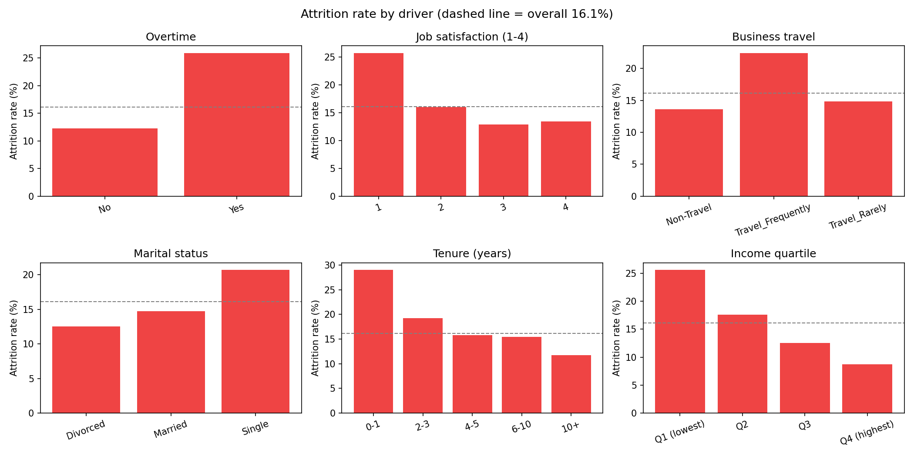
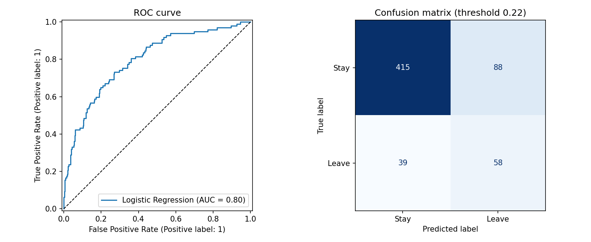
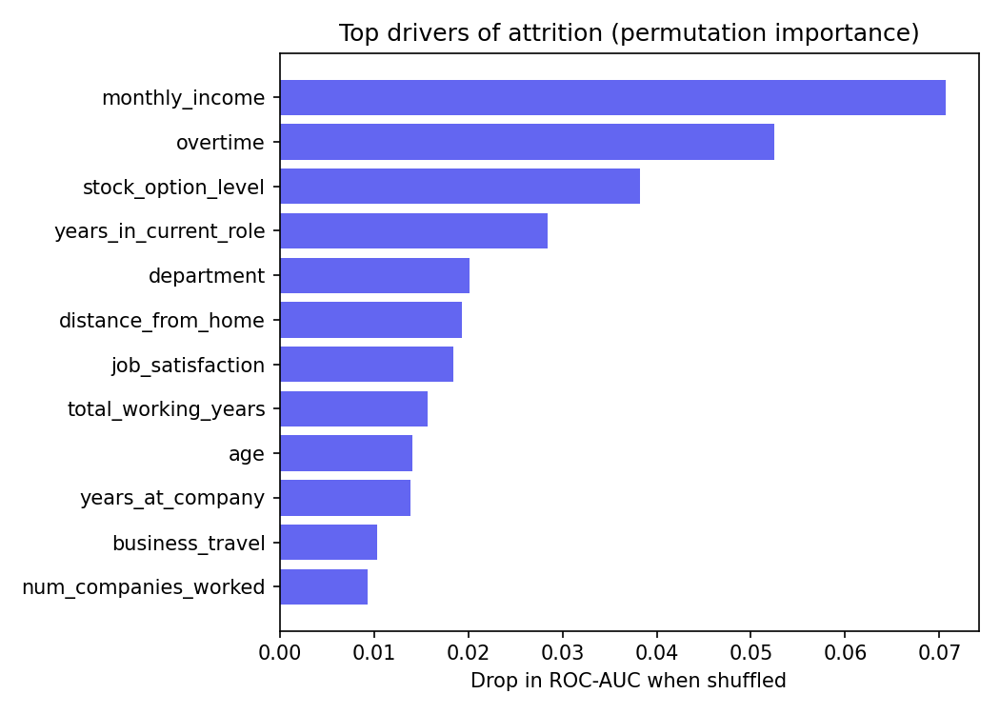

# 👥 Employee Attrition Prediction

Predict **which employees are likely to leave** and **why**, so HR can act before resignations happen. Includes EDA, model comparison, threshold tuning for an imbalanced target, explainable risk flags and a Streamlit app for HR teams.

> **Business question:** Replacing an employee is expensive. Can we flag at-risk employees early and understand what is driving it?

## Highlights

- **EDA** of attrition rate by overtime, satisfaction, travel, marital status, tenure and income
- **Leak-free ML pipeline:** feature engineering → imputation/scaling/one-hot encoding → model, all inside one scikit-learn `Pipeline` (raw columns in, probability out)
- Compares **Logistic Regression, Random Forest, Gradient Boosting** with 5-fold stratified CV (ROC-AUC)
- **Imbalanced data (~16% leavers)** handled by tuning the decision threshold on out-of-fold predictions (test set stays untouched) instead of distorting probabilities with class weights
- **Permutation importance** to identify the real drivers of attrition
- **Explainable output:** probability, risk band (Low / Medium / High) and plain-English risk factors per employee
- **Streamlit app:** single-employee form, batch CSV scoring with download, model & driver dashboard
- pytest suite (data schema, feature engineering, model sanity, unseen categories, risk logic)

## Project structure

```
employee-attrition-prediction/
├── app.py                   # Streamlit app
├── src/
│   ├── config.py            # paths + column definitions
│   ├── generate_data.py     # synthetic HR dataset (IBM-HR style)
│   ├── eda.py               # attrition by driver + chart
│   ├── features.py          # feature engineering + preprocessing
│   ├── train.py             # model comparison, threshold tuning, evaluation, plots
│   └── predict.py           # scoring + risk bands + risk factors (CLI + class)
├── tests/test_attrition.py
├── data/  models/  reports/
└── requirements.txt
```

## Quick start

```bash
git clone https://github.com/trishak23/employee-attrition-prediction.git
cd employee-attrition-prediction
python -m venv .venv && source .venv/bin/activate      # Windows: .venv\Scripts\activate
pip install -r requirements.txt

python -m src.generate_data      # creates data/employees.csv (3,000 employees)
python -m src.eda                # attrition drivers chart -> reports/figures/
python -m src.train              # trains, evaluates, saves model + plots
python -m src.predict --example  # score one employee
python -m src.predict --csv data/employees.csv --out reports/attrition_scores.csv
streamlit run app.py             # HR app
pytest                           # tests
```

## Using the real IBM HR Analytics dataset

Download *IBM HR Analytics Employee Attrition & Performance* from Kaggle, convert column names to snake_case
(`MonthlyIncome` → `monthly_income`, `OverTime` → `overtime`, `YearsSinceLastPromotion` → `years_since_last_promotion`, ...),
add an `employee_id` column, save as `data/employees.csv` and rerun `python -m src.train`. The column list is in `src/config.py`.

## Results (bundled synthetic data, seed 42, 600-employee hold-out)

| Model | CV ROC-AUC |
|---|---|
| **Logistic Regression** (selected) | **0.740** |
| Random Forest | 0.722 |
| Gradient Boosting | 0.698 |

| Hold-out metric | Value |
|---|---|
| ROC-AUC | 0.796 |
| PR-AUC (base rate 16%) | 0.494 |
| Recall at tuned threshold (0.22) | 0.60 |
| Precision at tuned threshold | 0.40 |
| F1 | 0.48 |

**Risk bands are meaningful:** actual attrition was ~7% in the *Low* band, ~23% in *Medium* and ~48% in *High* (vs 16% overall).

**Attrition drivers found (EDA + permutation importance):** low income (26% attrition in the lowest income quartile vs 9% in the highest), overtime (26% vs 12%), no stock options, frequent travel (22% vs 14%), single employees (21% vs 12–15%), new joiners (29% in year 0–1), low job satisfaction.

> ⚠️ These numbers come from a *synthetic* dataset built to behave like HR data, so they show the pipeline works rather than real-world truth. The modest ROC-AUC is intentional (real attrition is noisy), and it is typical of results on the real IBM dataset. Risk bands above were measured on data the model was trained on; for production, score only unseen employees.

## Recommended HR actions

| Finding | Action |
|---|---|
| Overtime doubles attrition | Rebalance workloads, cap overtime, add headcount |
| Low pay band, no stock options | Salary benchmarking, retention bonuses / equity |
| First-year employees leave most | Stronger onboarding, 30/60/90-day check-ins |
| Long gaps since promotion | Career-path reviews, internal mobility |
| Frequent travel | Travel rotation, remote alternatives |

## Ethics & responsible use

Predictions should support *conversations and support for employees*, not punish them. Protected attributes (gender, marital status) are in the data for analysis; audit model outputs for fairness before any real deployment and comply with local privacy law.

## Visuals





## Tech stack

Python · pandas · NumPy · scikit-learn · Matplotlib · joblib · Streamlit · pytest

## Possible extensions

- SHAP values for per-employee explanations
- Survival analysis (time-to-exit) with `lifelines`
- Fairness audit across gender / age groups
- Cost-sensitive threshold using the cost of replacing an employee

## License

MIT
